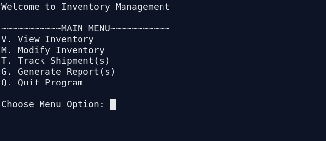
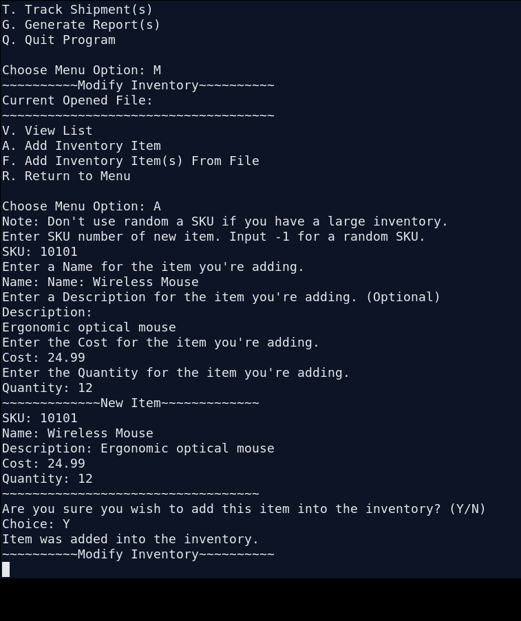
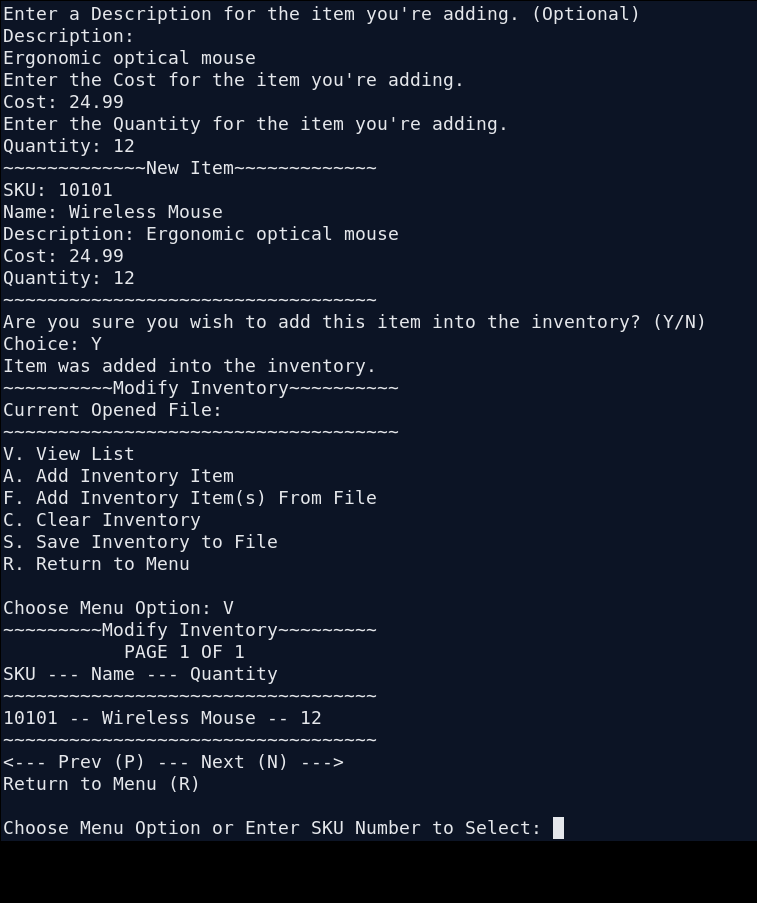
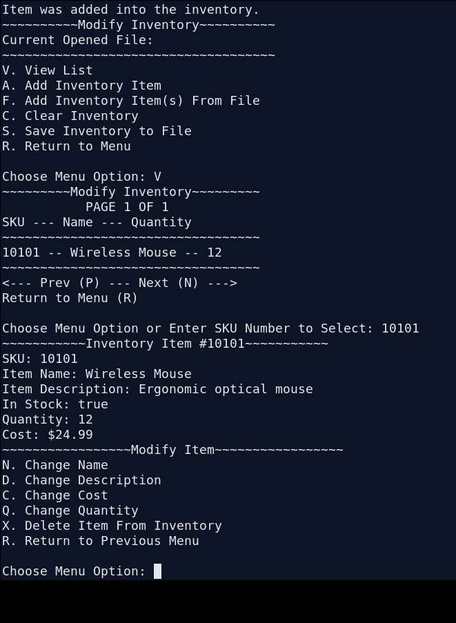
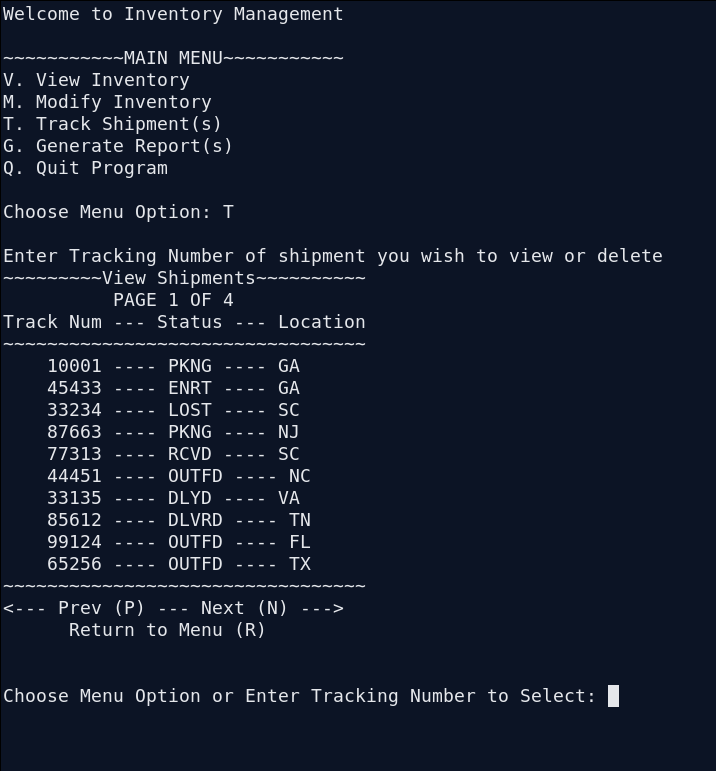
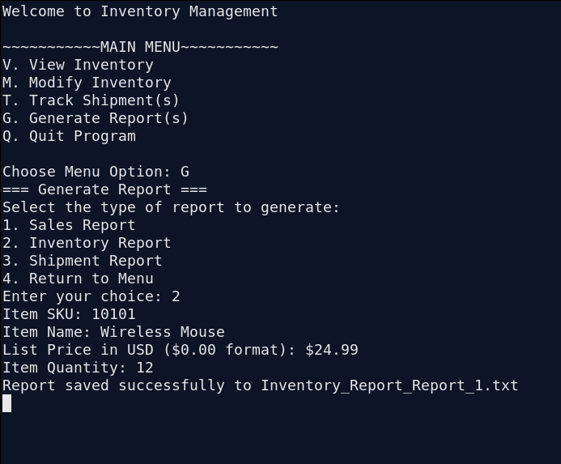
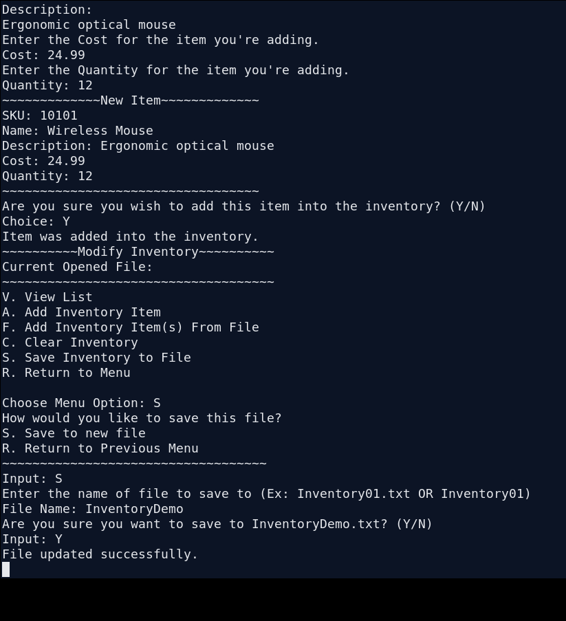

[Back to Portfolio](./)

Inventory Management System – Java Console Application
======================================================

- **Class:** CSCI 325
- **Grade:** A
- **Language(s):** Java
- **Source Code Repository:** [Inventory Management System](https://github.com/soverc89/Inventory-Management)

## Project description

Inventory Management System is a menu-driven Java console application designed to help a business organize its inventory, manage shipment records, and create basic reports. Users can add and view products, update item information, remove entries, and save inventory data to text files. The program also includes a shipment-tracking menu and a report-generation feature.

Each inventory item is represented by a stock keeping unit (SKU), name, description, quantity, and cost. Items are stored in an in-memory list while the application runs, with options to import and save inventory files for later use. The shipment feature loads records containing tracking numbers, statuses, and locations from a separate file. Users can browse these records and remove shipments when necessary.

The project demonstrates object-oriented programming through separate classes for inventory records, shipments, and reporting, while using file input/output and input validation to support practical business workflows. It was developed as a team project.

## How to compile and run the program

From the `InventoryManagmentSystem` directory, compile and run the application:

```bash
ant jar
java -jar dist/InventoryManagmentSystem.jar
```

The program opens in the terminal and displays its main menu.

## Program Design and Operation

**Main menu.** When the program starts, the user can choose to view inventory, modify inventory, track shipments, generate reports, or quit. The text-based menus guide the user through each operation.

  
**Fig. 1.** The main menu displays the application's four primary features and the option to quit.

**Adding inventory items.** Through the Modify Inventory menu, a user can enter an item's SKU, name, description, cost, and quantity. The application requests confirmation before adding the item and checks for duplicate SKU numbers.

  
**Fig. 2.** Adding a wireless mouse to the inventory and confirming its details.

**Browsing inventory.** Inventory records are presented in pages of up to ten items. Users can navigate through the list and select an item by entering its SKU.

  
**Fig. 3.** The inventory list displays each product's SKU, name, and available quantity.

**Viewing and modifying items.** Selecting an SKU displays an item's full record, including its description, stock status, quantity, and cost. From the modification menu, the user can change individual fields or delete the item.

  
**Fig. 4.** Viewing an item's details and the available editing and deletion options.

**Tracking shipments.** The system reads shipment information from `shipmentData.txt` and displays tracking numbers, status codes, and locations. Users can navigate through the shipment list, inspect a tracking number, and remove a shipment after confirmation. The shipment file is updated when the user returns to the main menu.

  
**Fig. 5.** The shipment-tracking interface showing shipment statuses, locations, and page navigation.

**Generating reports.** The reporting menu offers sales, inventory, and shipment reports. The user enters the relevant details, and the application writes a dated text report to a file. These reports use information supplied through the report prompts rather than automatically calculating results from the inventory list.

  
**Fig. 6.** Entering inventory-report details and receiving confirmation that a report was saved.

**Saving inventory.** Users can save the current inventory as a text file for future use or import an inventory file through the Modify Inventory menu. Inventory records are saved using a pipe-delimited text format.

  
**Fig. 7.** Saving the current inventory to a new text file.

## Additional Considerations

This project provided experience working with Java classes, inheritance, `ArrayList` collections, file input/output, and a modular console interface. The `Inventory` class manages the collection of products, while `InventoryItem` represents individual products. Separate `Shipments` and `GenerateReport` classes handle shipment data and report creation.

The application also uses confirmation prompts and basic input validation to reduce accidental changes. Its data is stored in local text files rather than in a database, keeping the implementation straightforward for a course project. The supplied version emphasizes local inventory and shipment management rather than a networked or multiuser system.

*The screenshots above were captured from the uploaded source code running locally with demonstration inputs.*

[Back to Portfolio](./)
