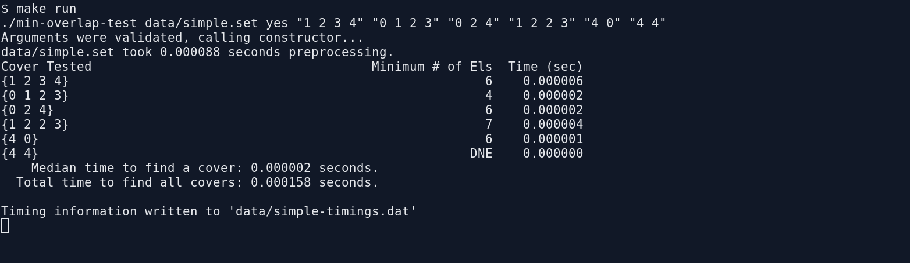
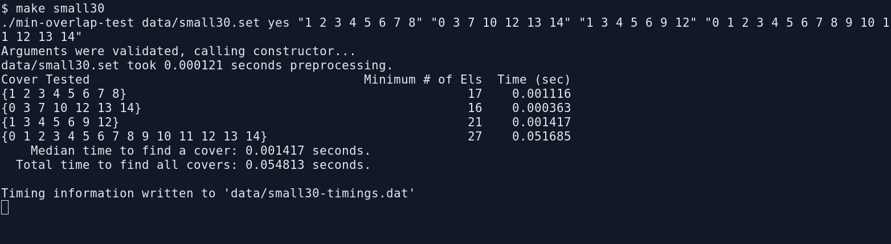

[Back to Portfolio](./)

Minimum Overlap Coverage – C++ Set-Coverage Algorithm
====================================================

- **Class:** CSCI 315 (Spring 2025)
- **Grade:** *[Enter project/course grade]*
- **Language(s):** C++ (C++20)
- **Source Code Repository:** [CSCI 315 – Project 3](https://github.com/soverc89/CSCI-315-2025-Spring-AT/tree/master/project3)  
  *(This link uses the repository address you provided and the `project3` folder path from the uploaded ZIP. If your portfolio requires a private repository, replace it with that repository's URL and, if desired, add instructions for requesting access.)*

## Project description

Minimum Overlap Coverage is a command-line C++ program that finds an efficient combination of sets to cover a requested collection of values. The goal is to include every requested value while minimizing the total number of elements across the selected sets. The assignment presents this as a classroom scheduling problem: students belong to different project groups, and a professor wants enough groups to present to include specified students while assigning as few total grades as possible.

The program reads a text file containing groups of integer IDs, accepts one or more coverage queries from the command line, and calculates the minimum total number of group-member occurrences needed for each query. A query can contain duplicate values, meaning the corresponding student must be covered more than once. If no combination of available groups can satisfy a query, the program reports `DNE` (*Does Not Exist*). Along with the results, it displays execution times and saves timing data to a separate file.

## How to compile and run the program

From the directory containing `project3`, compile and run the included example cases:

```bash
cd project3
make
make run
```

To run another included test set, use `make small30`, or invoke the compiled program directly with a set file and quoted coverage queries:

```bash
./min-overlap-test data/simple.set no "0 2 4" "4 4"
```

## Program Design and Operation

The project uses a console interface rather than a graphical user interface. When launched, the program validates its command-line arguments, reads the selected `.set` file, and prints a table showing each requested cover, its minimum number of elements, and the time required to find the result.

**Reading and organizing the sets.** The `MinimumOverlap` class loads each line of the input file as a separate group, storing its members in an `unordered_set`. It also builds a reverse lookup table mapping each element to the groups containing it. This makes it easier to identify candidate groups that could satisfy a coverage request.

**Finding the minimum coverage.** Each query is converted into an element-frequency map so duplicate IDs are handled individually. The solver uses recursive backtracking to explore combinations of groups. A priority queue ranks promising groups according to how well they match remaining required elements, with penalties for unnecessary elements. Branches are pruned when they cannot improve the best solution found so far. The final answer represents the total number of elements in the chosen groups, not simply the number of groups selected.

**Reporting the results.** The program processes multiple queries in one execution, reports `DNE` when a valid cover cannot be found, and displays the median and total search times. It also writes a tab-separated timing file next to the input data file for later performance analysis.

### Screenshots and numbered captions

The following screenshots were captured from the uploaded program after successfully compiling and running it. Execution times will vary between computers.

  
**Fig. 1.** Running the included `simple.set` examples displays the minimum coverage for six queries, including a query that cannot be satisfied.

  
**Fig. 2.** Running the `small30.set` test cases shows calculated minimum cover sizes, individual execution times, and timing statistics saved to a data file.

  
**Fig. 3.** The program returns `DNE` when a requested ID is absent or when the available groups cannot cover a repeated ID enough times.

  
**Fig. 4.** The program rejects an invalid command-line option and displays an error rather than attempting to process the request.

## Additional Considerations

This project demonstrates the use of recursive backtracking, branch pruning, priority queues, hash-based containers, and algorithmic performance measurement. Because the number of possible set combinations can increase rapidly, the implementation attempts to reduce unnecessary work by scoring candidate groups and discarding searches that cannot beat the current best result.

The program also separates the search algorithm from its testing interface: `MinimumOverlap.hpp` and `MinimumOverlap.cpp` define and implement the coverage logic, while `main.cpp` handles command-line input, output formatting, and timing. The included data sets allow the same algorithm to be exercised against increasingly challenging inputs. In the supplied implementation, the `yes`/`no` argument is validated, but the optional verbose-print flag is not currently used by the search routine.

[Back to Portfolio](./)
