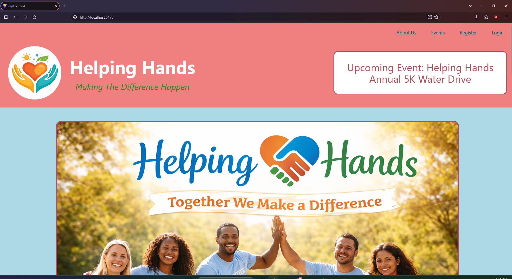
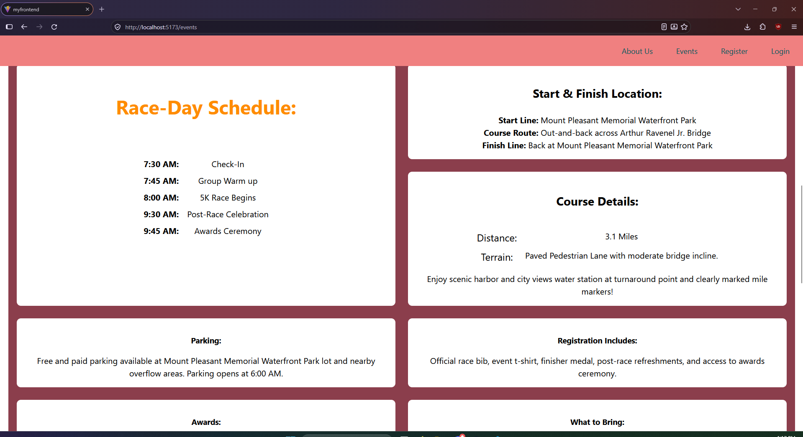
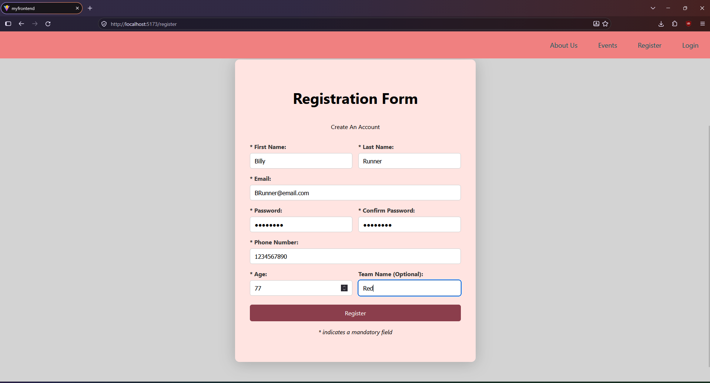
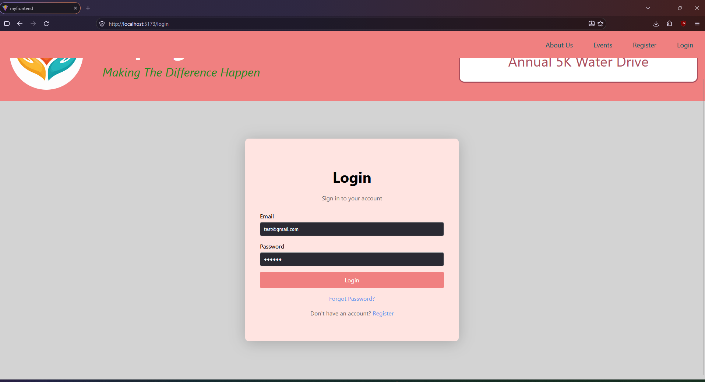
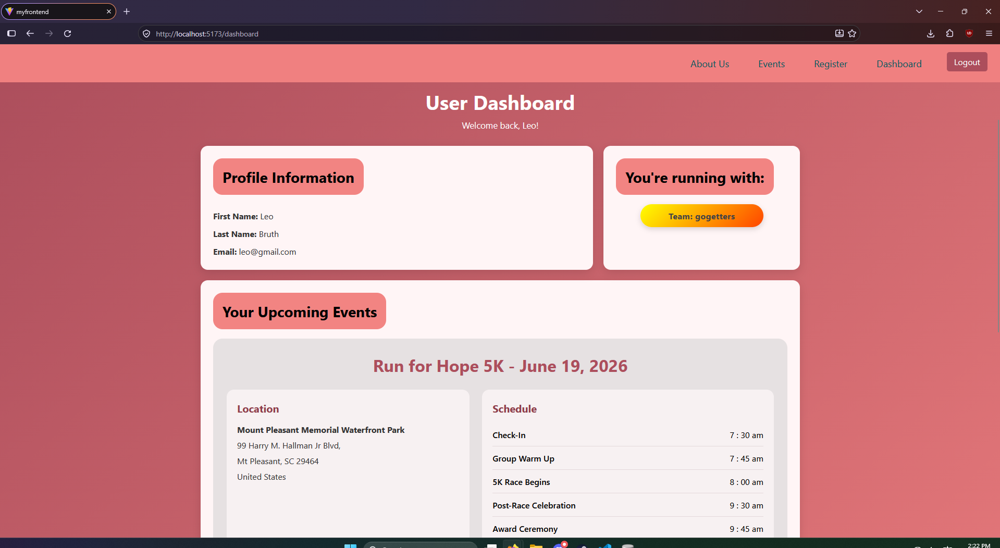
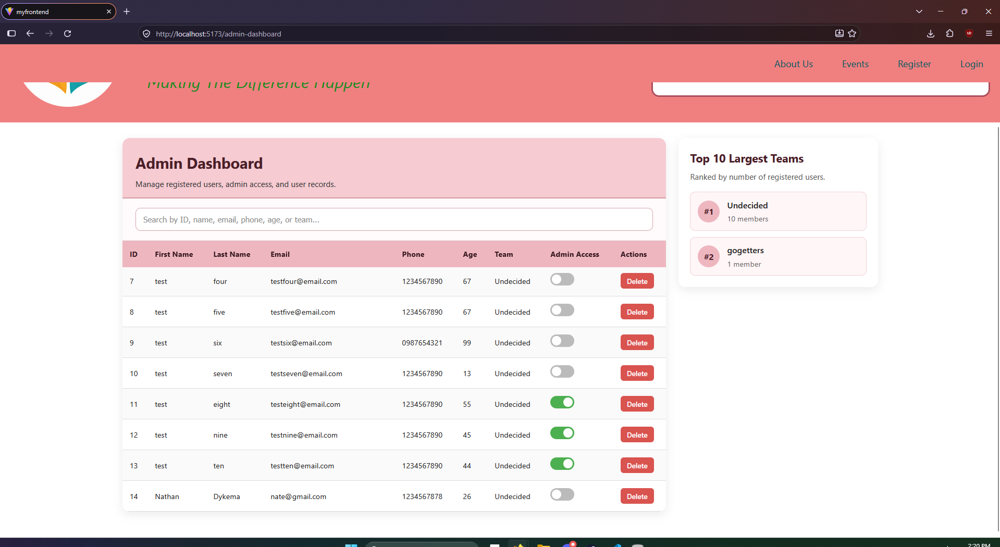

[Back to Portfolio](./)

Helping Hands 5K – Nonprofit Web Application
============================================

- **Class:** CSCI 334 – User Interface Programming
- **Grade:** B
- **Language(s):** JavaScript (React/JSX), C#, CSS, HTML, SQL (through SQLite/Entity Framework Core)
- **Source Code Repository:** [Helping Hands 5K Nonprofit Project](https://github.com/soverc89/5k-nonprofit-project)  
  *(Repository access may need to be requested if it is private.)*

## Project description

Helping Hands 5K is a full-stack web application developed for a fictional nonprofit organization that hosts a charity race to provide shoes to children in Africa. The website introduces visitors to the organization, describes its mission, advertises the 5K event, and provides account registration and login functionality for participating runners.

The project combines a responsive React frontend with a C# ASP.NET Core backend. Public-facing pages present the organization, its team, and race information. Registered users can access a dashboard showing their profile, assigned team, and event details. An administrator dashboard allows authorized users to inspect registrations, search for participants, manage administrator privileges, delete accounts, and view team rankings.

User records are stored in an SQLite database using Entity Framework Core. The React application communicates with the backend through HTTP API requests to register users, validate logins, and manage participant records. Development was organized through feature branches and sprint integration branches, reflecting a collaborative Agile/Scrum workflow.

## How to compile and run the program

This project consists of two applications that must be started separately: the ASP.NET Core backend and the React frontend.

Prerequisites:

- **.NET 10 SDK** for the backend
- **Node.js and npm** for the frontend
- A web browser and, optionally, Visual Studio Code or Visual Studio

Download or clone the repository:

```bash
git clone https://github.com/ndykema/5k-nonprofit-project.git
cd 5k-nonprofit-project
```

### Start the backend

In the first terminal:

```bash
cd MyBackend
dotnet restore
dotnet run
```

The project documentation specifies the API at `http://localhost:5160`. If the development server uses a different address, set the frontend's API URL to that address. You can test connectivity by visiting `/api/tasks` on the backend server.

### Start the frontend

In a second terminal, from the repository root:

```bash
cd MyFrontEnd
npm install
```

Create a file named `.env` inside `MyFrontEnd` with the following contents:

```env
VITE_API_URL=http://localhost:5160
```

Then start the development server:

```bash
npm run dev
```

Open the local address printed by Vite, typically `http://localhost:5173`. Both servers need to remain running for registration, login, and administrative actions to work.

For an optional production build of the frontend, run:

```bash
npm run build
```

## UI Design and Program Operation

The application uses separate pages for visitors, registered runners, and administrators. Navigation between the pages is handled by React Router, while React state and browser local storage support the frontend's session-related interface.

**Public pages.** Visitors can explore the About page to learn about Helping Hands and the people associated with the nonprofit. The Events page provides race information, including schedule, location, parking, and other participant details. These pages use image assets, styled sections, and navigation links to direct visitors toward registration.

**Registration.** The registration form collects participant details and performs client-side validation. When submitted, it sends the information to the backend's `POST /api/register` endpoint. The backend saves the new participant using Entity Framework Core and SQLite. Under the project's implemented rules, the first account registered is automatically assigned administrator privileges.

**Login and runner dashboard.** The login form sends the entered credentials to `POST /api/login`. If the backend accepts them, it returns basic user information, an assigned role, and a generated token. The frontend then directs the visitor to the appropriate dashboard. Regular users see profile information, their team, race-day information, and a route map.

**Administrator dashboard.** The administrative interface retrieves registered users from `GET /api/users`. It supports searching and reviewing participant accounts, toggling administrative roles through `PUT /api/users/{id}`, deleting accounts through `DELETE /api/users/{id}`, and viewing a top-ten team listing.

### Screenshots and numbered captions

The following images need to be captured from the running application and saved in the portfolio's `images` directory. They are deliberately marked as **pending**: the supplied ZIP did not contain verified screenshots of the running website, and the app could not be launched in the current environment. Replace each placeholder with a real screenshot before publishing.



**Fig. 1.** Helping Hands landing/About page displaying the nonprofit's mission and site navigation. *[Screenshot needed]*


**Fig. 2.** Events page displaying information about the charity 5K and race-day activities. *[Screenshot needed]*


**Fig. 3.** Runner registration form used to create a participant account. *[Screenshot needed]*


**Fig. 4.** Login page where registered participants enter their credentials. *[Screenshot needed]*


**Fig. 5.** Runner dashboard presenting participant information, team assignment, and race details. *[Screenshot needed]*


**Fig. 6.** Administrator dashboard used to review registrations and manage participant accounts. *[Screenshot needed]*

[Back to Portfolio](./)
