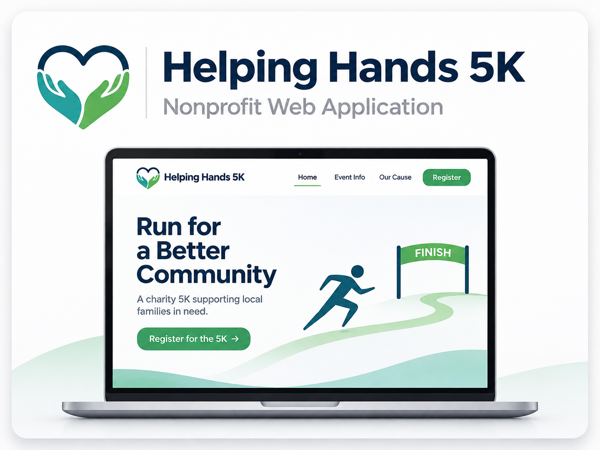
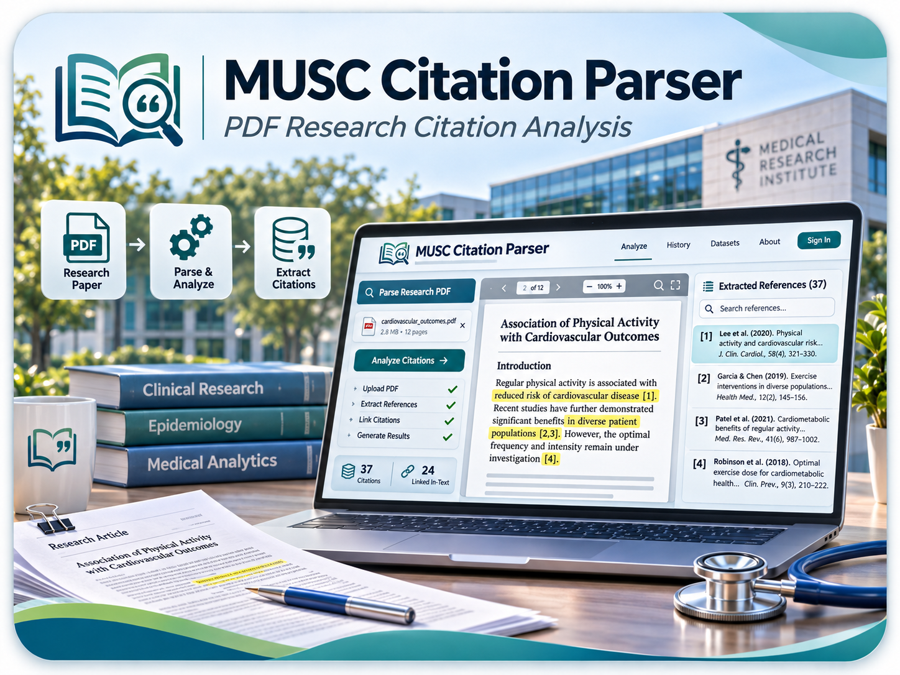
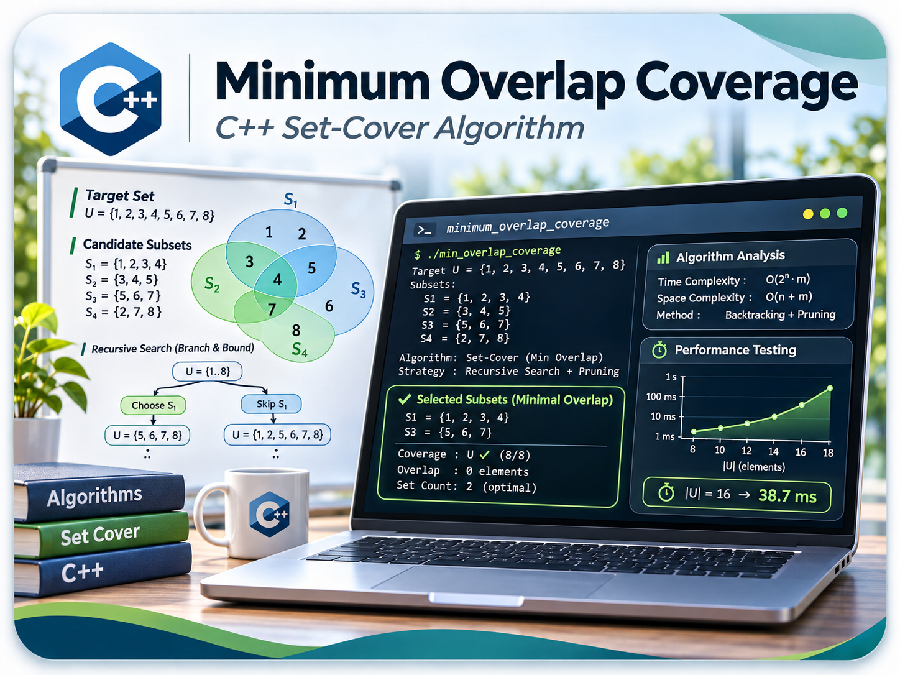
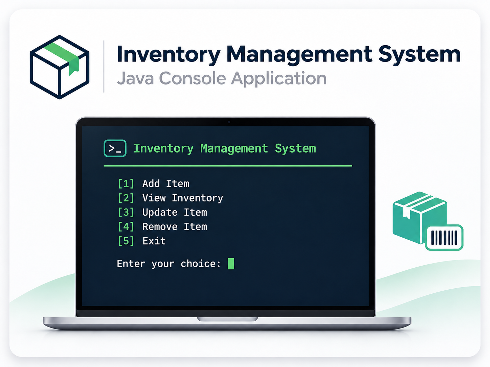

Portfolio
=========

Programming Projects
--------------------

*For access to my private project repositories, please [email me](mailto:example@csustudent.net?subject=GitHub%20Access) with the subject line, GitHub Access.

---
### [Helping Hands 5k | CSCI 301](helping-hands-5k-project.md)

---
### [MUSC Citation Parser | CSCI 315](MUSC_Citation_Parser_Portfolio.md)

---
### [Minimum Overlap | CSCI 325](MinimumOverlap_Project3.md)

---
### [Inventory Management | CSCI 332](Inventory_Management_Portfolio.md)

---

Ethics Papers
-------------

### [Cybercrime: Challenges in Law Enforcement's Ability to Keep Up with Rapid Technological Advancements](pdf/Cybercrime_challenges_in_Law_Enforcement.pdf)

-   **Class:** CRIM 227
-   **Grade:** A

### [An Ethical Analysis of Profiling in Modern America](pdf/Examining_Racial_Bias_Within_the_Death_Penalty.pdf)

-   **Class:** CRIM 403
-   **Grade:** A

### [The Morris Worm Incident of 1988](pdf/Morris_Worm_Incident.pdf)

-   **Class:** CRIM 405
-   **Grade:** A

---

Presentations
-------------

### [Synthetic Data for Small Datasets](https://youtu.be/7MAu3tWlY6I)

- **Class:** CSCI 442
- **Grade:** A

### [The SolarWinds Cyber Attack](https://youtu.be/Y-1tRFyXkZg)

- **Class:** CSCI 352
- **Grade:** A

---

Page template forked from <a href="https://github.com/csu-cs/csci-portfolio">CSU-CS</a>

<!-- Remove above link if you don't want to attributive -->
